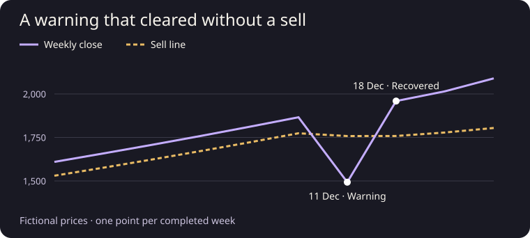

# Trend Line


[Open the editable Pine indicator](trend_line.pine) · [Backtest strategy](trend_line_backtest.pine) · [Python reference model](research/model.py)

I built this indicator to follow an established weekly trend. Gold means the model holds. Grey means it waits in cash. Open a standard candlestick chart in TradingView, copy the entire indicator into a new Pine Editor script and choose **Add to chart**. Use a 1W chart for the strategy.

### A warning that never became a sell

In the synthetic example above, the observation confirmed on 11 December 2023 closed at 1,492.71 and triggered a warning. The model still held. The next weekly observation closed at 1,959.18, the warning cleared, and there was no sell. The example uses invented prices and the same Python model as the tests. Run it yourself:

```sh
python3 scripts/warning_example.py
python3 -m unittest discover -s tests
```

### How a signal reaches the chart

The model waits for the weekly close. A sell needs confirmation across two qualifying closes. Intraday movement and the distance to the line are context. Match the feed, timeframe, chart type, and loaded history when comparing results. The strategy defaults to 10,000 initial capital, 99% exposure, 0.3% commission per side and zero strategy slippage. Set realistic slippage ticks in Strategy Properties. The on-chart trade calculator has its own percentage slippage assumption.

### Compare your TradingView chart with the reference model

Use standard 1W candles with the default Trend Line settings. If your account supports chart-data export, load the full available history for the same feed and export a CSV with the **indicator or strategy** and its diagnostic plots. Export one script at a time. From this repository run:

```sh
python3 scripts/check_tradingview_export.py chart.csv --as-of 2026-11-02T00:00:00Z
```

Replace the cutoff with the last weekly close you want to check. The command uses the OHLC prices in your file and checks each completed bar's trend line, regime, warning, signal and confirmation time. It exits successfully on agreement. A mismatch prints the affected bar, field and both values. A cropped history, missing plots, or custom model settings cannot validate the default build. Keep the CSV on your own computer; the checker runs offline. If you chose the classic exit rule, pass `--model weekly-1.0.0`.

You can also check the signals entirely inside TradingView. In a temporary copy of either Pine script, append [the independent weekly check](tests/native_weekly_reference.pinepart), then add that copy to a standard 1W chart with default inputs. The table compares the production calculations with a separate implementation on the same candles. It reports how many completed bars it checked, any differences, and any input it couldn't verify. Use the original script without the check for normal charting.

### TradingView verification

On 3 November 2026, both the 1.6.6 indicator and its companion strategy ran on TradingView's standard BITSTAMP:BTCUSD weekly candles. Each matched the independent check on **794 completed weeks** through the close on 2 November, including **25 trend changes and 19 warning starts**. Both runs had zero calculation or event differences and zero unsupported samples. The still-open week was excluded.

For example, the indicator marked a BUY on 12 May 2025 and a SELL on 17 November 2025. The same dates appeared in the strategy's trade list. On this continuous market, the next weekly bar opens when the preceding bar closes. The check covers the historical weekly signals on this feed. Live alert delivery and trade execution were outside its scope.

### Rebuild and contribute

Edit the shared files in `pine/`, run `python3 scripts/build_pine.py`, and commit both generated Pine files. A good first contribution is a synthetic sequence that exposes a case where the Pine and Python outputs disagree. Include the feed and observation time when reporting a chart discrepancy.

Version **1.6.6** uses the weekly 1.5.0 model. Run the Python suite above to check the reference model, backtest, and export comparison. MIT covers the original code. Supply your own instrument history if extending the example to real data.
